<div align="center">

# 🧪 LabFlow: Research Lab Workspace

**A full-stack project and task manager for small research teams.**<br>
Plan projects, run work on a drag-and-drop Kanban board, track papers from idea to publication, and see who is overloaded before deadlines slip.

[](https://github.com/Varshini-arsh/labflow-research-workspace/actions/workflows/tests.yml)


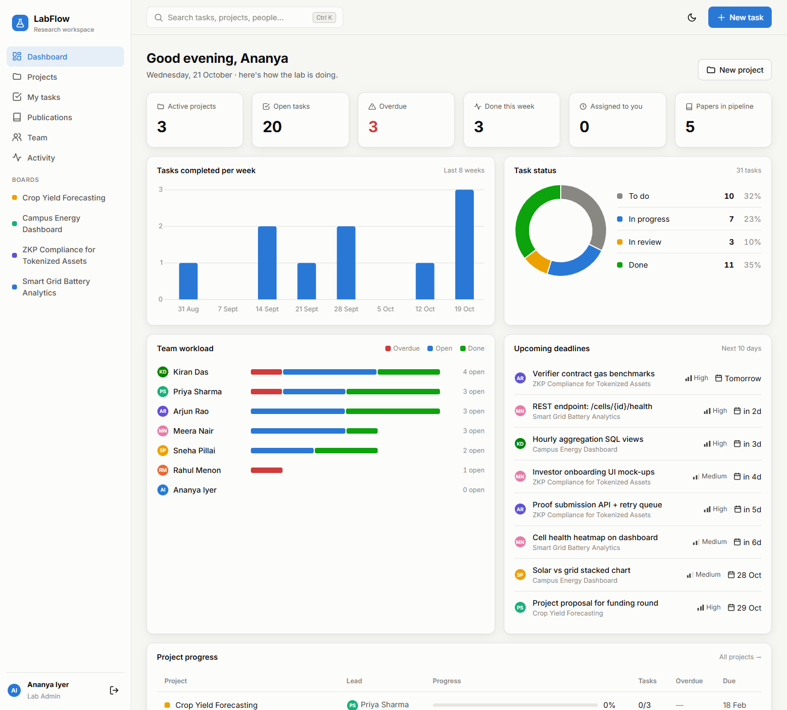

</div>

---

## 📑 Table of contents

1. [What is LabFlow?](#-what-is-labflow)
2. [Case study: the lab behind the demo](#-case-study-the-lab-behind-the-demo)
3. [Features](#-features)
4. [Roles and permissions](#-roles-and-permissions)
5. [Screenshots](#-screenshots)
6. [Tech stack](#-tech-stack)
7. [Architecture](#-architecture)
8. [Database design](#-database-design)
9. [How the key features work](#-how-the-key-features-work)
10. [REST API reference](#-rest-api-reference)
11. [Getting started](#-getting-started)
12. [Testing and CI](#-testing-and-ci)
13. [Project structure](#-project-structure)
14. [Design decisions](#-design-decisions)
15. [Future improvements](#-future-improvements)
16. [Author and license](#-author-and-license)

---

## 💡 What is LabFlow?

Research labs often track work in spreadsheets and chat threads. That makes simple questions hard to answer:

- *What is overdue right now?*
- *Who has too much on their plate?*
- *Where is that paper in the review process?*
- *What changed on my project while I was away?*

LabFlow answers all of them in one place. It is a **Django REST API** with a **MySQL database** and a **single-page frontend written in plain HTML, CSS and JavaScript**: no frontend framework and no build step.

## 🏛 Case study: the lab behind the demo

The app ships with a realistic dataset (`python manage.py seed_demo`) modelled on a university research lab:

| Person | Role | Title |
|---|---|---|
| Ananya Iyer | Lab Admin | Lab Director |
| Rahul Menon | Researcher | Senior Research Engineer |
| Priya Sharma | Researcher | ML Researcher |
| Arjun Rao | Researcher | Backend Engineer |
| Meera Nair | Intern | Full-stack Intern |
| Kiran Das | Intern | Data Intern |
| Sneha Pillai | Intern | Frontend Intern |

They run five projects with 31 tasks, comments, 6 papers and an activity history:

| Code | Project | Status | What it is about |
|---|---|---|---|
| `GRID` | Smart Grid Battery Analytics | Active | Predicting battery state-of-health from telemetry and flagging thermal risk |
| `ZKRWA` | ZKP Compliance for Tokenized Assets | Active | Zero-knowledge eligibility proofs before ERC-3643 token transfers |
| `CAMPUS` | Campus Energy Dashboard | Active | Live electricity and solar data per campus building |
| `AGRI` | Crop Yield Forecasting | Planning | Satellite and rainfall data for district-level yield forecasts |
| `WEB` | Lab Website Revamp | Completed | People directory, publication list and project pages |

All dates are generated **relative to the day you run the seed**, so "overdue" and "due tomorrow" always make sense.

## ✨ Features

### 📊 Dashboard
- **Six stat tiles** (active projects, open tasks, overdue, done this week, assigned to you, papers in pipeline). Each one clicks through to a filtered view.
- **Tasks completed per week**: a bar chart of the last 8 weeks.
- **Task status**: a doughnut chart with counts and percentages.
- **Team workload**: a stacked bar per person (overdue, open, done) from a hand-written SQL query.
- **Upcoming deadlines** for the next 10 days, and a **project progress** table.

### 🗂 Projects and Kanban board
- Project cards with a colour, progress bar, members and overdue count, plus a status filter (Planning, Active, On hold, Completed).
- Create and edit projects: name, code, colour, lead, members, dates (with validation), description.
- **A Kanban board per project** with To do, In progress, In review and Done columns.
- **Drag and drop** between and within columns:
  - a floating card preview follows the cursor, with a drop marker showing where it lands
  - the board auto-scrolls when you drag near its edge
  - the UI updates instantly and rolls back if the server refuses
- Filter the board by text, assignee ("Only mine") or priority, and add a task straight into any column.

### 📝 Task drawer
- Click any task to open a side panel and edit the title, status, priority, assignee, due date, tags and description. **Changes save as you make them.**
- **Comment thread**: press Ctrl+Enter to send.
- **Overdue** and **Read-only for you** badges. Read-only applies when your role doesn't allow edits.

### ✅ Task list, 📚 publications, 👥 team, 🕒 activity
- **Task list:** "Assigned to me" or "Everyone", status toggles, overdue-only, and search as you type.
- **Publication pipeline:** Idea → Drafting → Submitted → Accepted → Published, with one-click "advance stage".
- **Team page:** open, done and overdue counts per person. Click a person to see their tasks.
- **Activity feed:** an audit trail of every change (who, what, when), filterable by project.

### 🎛 Across the whole app
- **Ctrl+K command palette** to search pages, projects, tasks and people.
- **Light and dark mode** (follows the OS by default, with a toggle that remembers your choice).
- Toast notifications, loading skeletons and empty states.
- **Responsive layout**: a collapsible sidebar on phones and swipeable board columns.
- Keyboard accessible: focus rings, Enter to open, Esc to close.
- **One-click demo logins** on the sign-in page.

## 🔐 Roles and permissions

The rules live in one place, [`core/permissions.py`](core/permissions.py), and are **enforced by the API**. The UI only mirrors them, for example by showing a task as read-only.

| Action | Lab Admin | Researcher | Intern |
|---|:-:|:-:|:-:|
| View projects, tasks, papers, team | ✅ | ✅ | ✅ |
| Create a project | ✅ | ✅ | ❌ |
| Edit a project | ✅ | Only projects they lead | Only projects they lead\* |
| Delete a project | ✅ | ❌ | ❌ |
| Create a task, comment, add a paper | ✅ | ✅ | ✅ |
| Edit or move a task | ✅ any | ✅ any | Only tasks **assigned to** or **created by** them |
| Delete a task | ✅ | If they lead the project or created the task | If they created it |
| Delete a paper | ✅ | ✅ | ❌ |

\* The project form only offers researchers and admins as leads, so in practice interns don't edit projects.

## 📸 Screenshots

| | |
|:-:|:-:|
| **Sign-in with demo accounts**<br>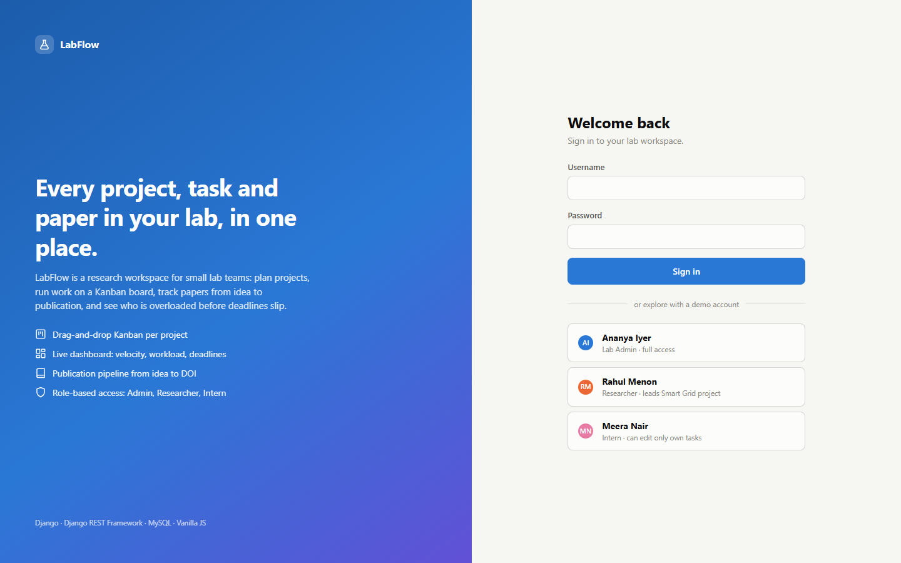 | **Dashboard (dark mode)**<br>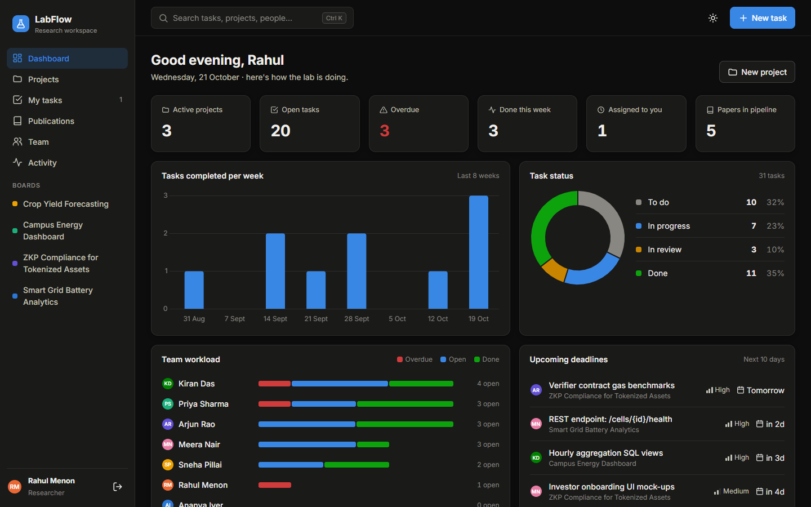 |
| **Kanban board**<br>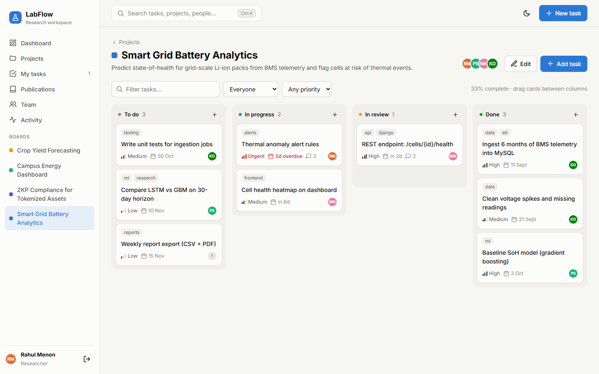 | **Dragging a card**<br>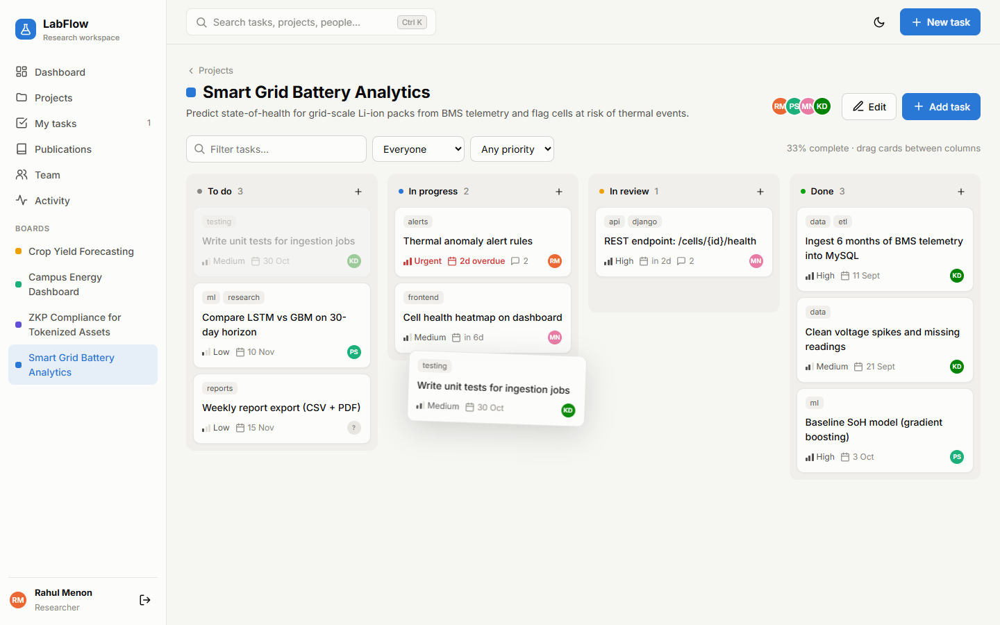 |
| **Task drawer with comments**<br>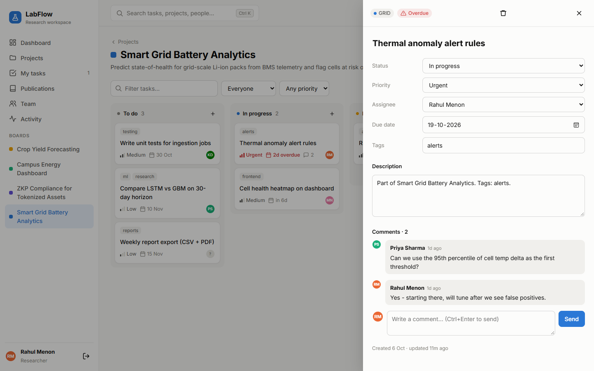 | **Intern sees a read-only task**<br>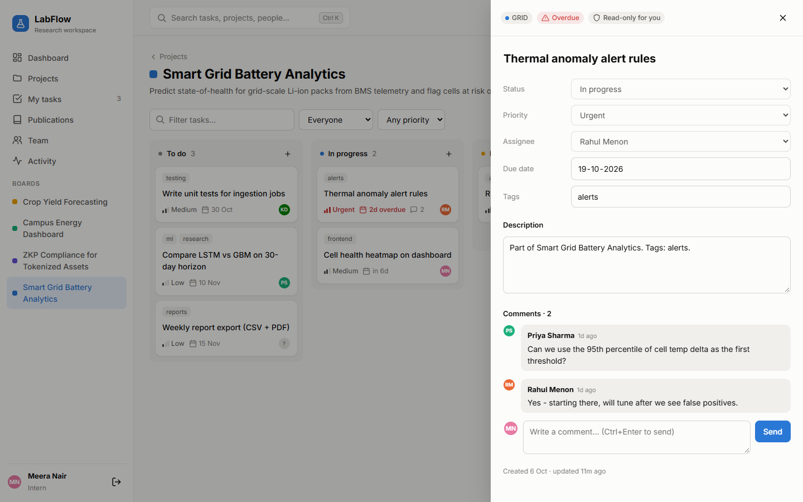 |
| **Publication pipeline**<br>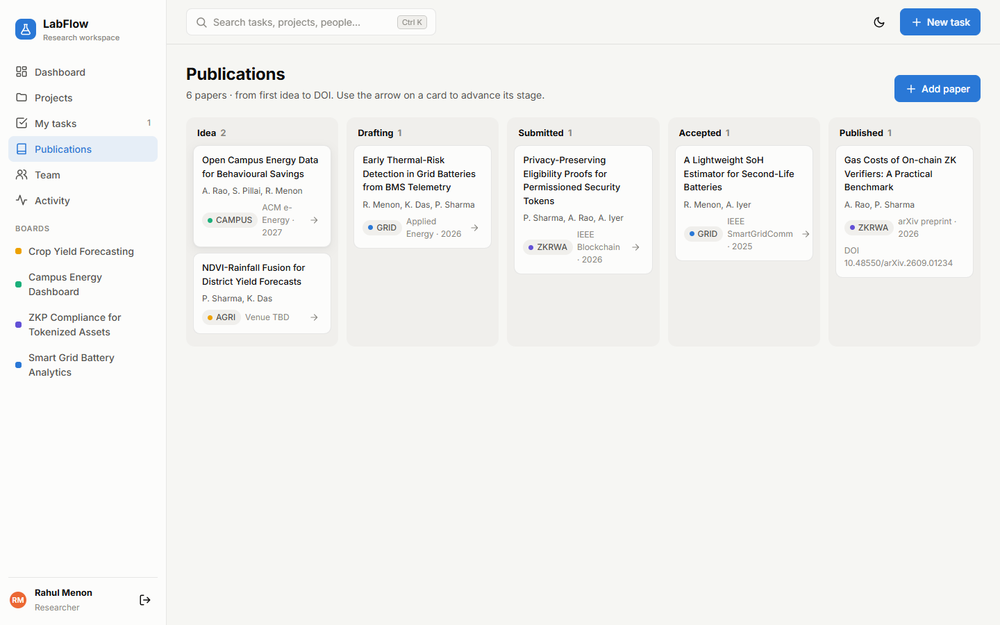 | **Ctrl+K command palette**<br>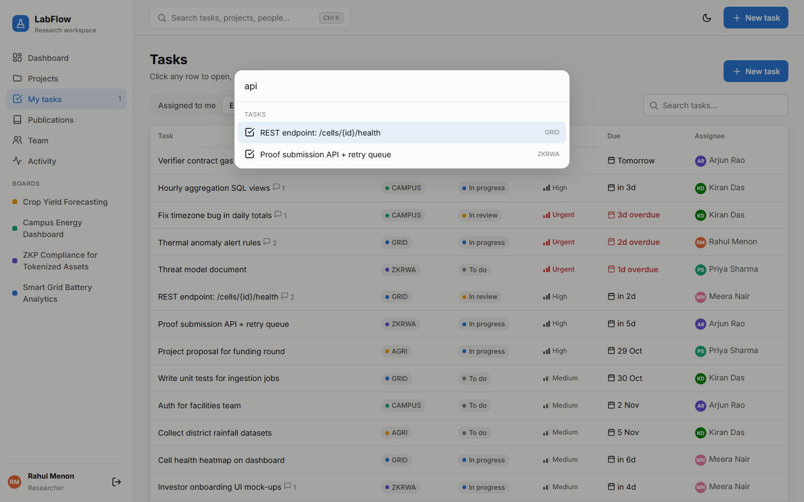 |
| **Team workload**<br>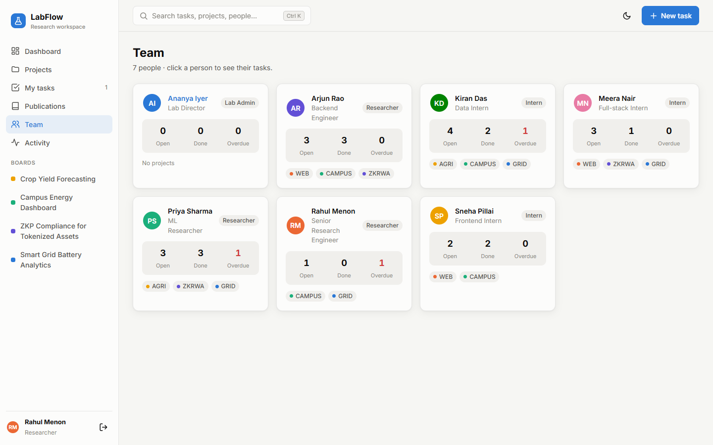 | |

## 🧰 Tech stack

| Layer | Technology | Version | What it is used for |
|---|---|---|---|
| Language | **Python** | 3.12 | Backend code |
| Web framework | **Django** | 5.1.4 | Models and ORM, migrations, auth, sessions, CSRF, admin site, templates, test runner |
| API | **Django REST Framework** | 3.15.2 | ViewSets and routers, serializers and validation, permissions, custom actions, browsable API |
| Database | **MySQL** | 8.4 | Main relational database (run with Docker Compose) |
| Database (fallback) | **SQLite** | 3 (bundled with Python) | Zero-setup local runs and quick tests |
| MySQL driver | **PyMySQL** | 1.1.1 | Pure-Python driver, so no C compiler is needed on Windows |
| MySQL auth | **cryptography** | 43.0.3 | Lets PyMySQL use MySQL 8's default `caching_sha2_password` login |
| Raw SQL | Hand-written `SELECT … JOIN … GROUP BY` | n/a | The team-workload report (portable across SQLite and MySQL) |
| Markup | **HTML5** + Django templates | n/a | Login page and single-page app shell, SVG icon sprite |
| Styling | **CSS3** | n/a | Design tokens (custom properties), Grid and Flexbox layouts, light and dark themes, `color-mix()`, media queries, reduced-motion support |
| Frontend logic | **Vanilla JavaScript** (ES2020+) | n/a | Hash router, `fetch()` API client, Pointer Events drag and drop, `async`/`await`, MutationObserver. No framework, no bundler |
| Charts | **Chart.js** | 4.4.1 (cdnjs) | Weekly velocity bar chart and status doughnut |
| Font | **Inter** | n/a | Loaded from Google Fonts |
| Icons | Hand-drawn inline **SVG sprite** | n/a | 25 icons in [`templates/icons.html`](templates/icons.html), with no icon library |
| Auth | Django **session authentication** + **CSRF** tokens | n/a | Login, role checks, protecting state-changing requests |
| Testing | Django test runner + DRF **`APITestCase`** | n/a | 12 API tests |
| CI | **GitHub Actions** | n/a | Runs check, migrate, seed and tests on **SQLite and MySQL 8.4** for every push |
| Containers | **Docker Compose** | n/a | One-command local MySQL |
| Version control | **Git** + **GitHub** | n/a | Source control and hosting |

## 🏗 Architecture

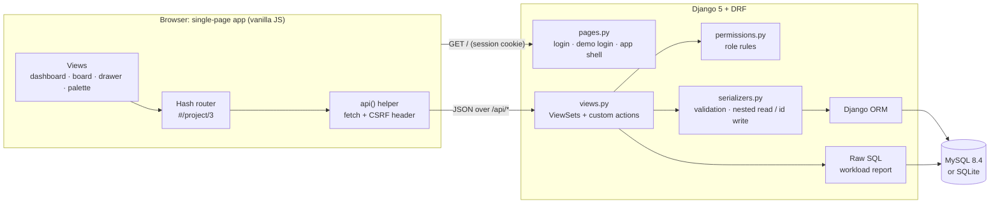

**One request, end to end** (dragging a card to "In review"):

1. The browser updates the board immediately (**optimistic UI**), then sends `POST /api/tasks/42/move/ {"status": "review", "position": 0}` with the session cookie and `X-CSRFToken` header.
2. DRF authenticates the session, and `permissions.can_edit_task()` checks the user's role.
3. Inside a **database transaction**, the target column's rows are locked (`select_for_update`), the task is inserted at the new index, and the column is renumbered.
4. An `Activity` row records "Rahul moved to In review".
5. The updated task comes back as JSON. If anything fails, the browser rolls the card back and shows the error.

## 🗄 Database design

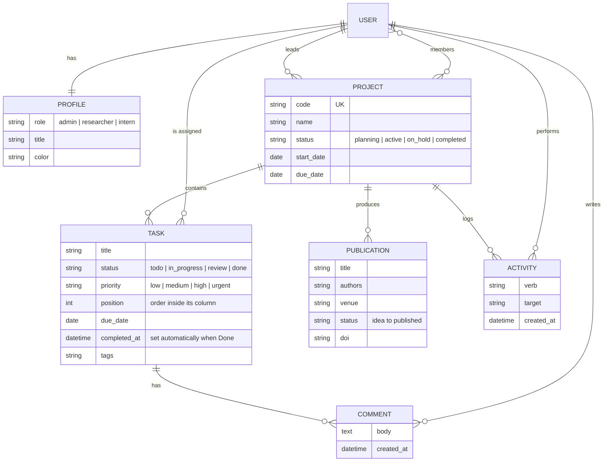

**Indexes** match the queries the app actually runs:

| Index | Speeds up |
|---|---|
| `task (project_id, status)` | Loading a board column |
| `task (assignee_id, status)` | "My tasks" and the workload report |
| `task (due_date)` | Overdue and upcoming-deadline queries |
| `project.code` (unique) | Short project codes like `GRID` |

## ⚙️ How the key features work

<details>
<summary><b>Drag and drop that saves the order</b></summary>

- **Frontend** ([`static/js/app.js`](static/js/app.js)): built on **Pointer Events** rather than the HTML5 drag-and-drop API.
  - A press becomes a drag only after the pointer moves 6 px, so a plain click still opens the task drawer.
  - A cloned "ghost" card follows the cursor, and a drop marker shows the insertion point.
  - The board scrolls sideways near its edges.
  - The click that ends a drag is swallowed so the drawer doesn't open by accident.
- **Backend** (`TaskViewSet.move`):
  - validates the target status
  - locks the destination column with `select_for_update()` inside `transaction.atomic()`
  - inserts the task at the requested index and writes new `position` values only for rows that changed
- **Optimistic UI**: the card moves instantly. If the API returns an error (for example, an intern dragging someone else's task), the previous state is restored and a toast explains why.
</details>

<details>
<summary><b>Team workload with hand-written SQL</b></summary>

```sql
SELECT u.id,
       SUM(CASE WHEN t.id IS NOT NULL AND t.status <> 'done' THEN 1 ELSE 0 END) AS open_tasks,
       SUM(CASE WHEN t.status = 'done' THEN 1 ELSE 0 END)                        AS done_tasks,
       SUM(CASE WHEN t.status <> 'done' AND t.due_date < %s THEN 1 ELSE 0 END)   AS overdue_tasks
FROM auth_user u
LEFT JOIN core_task t ON t.assignee_id = u.id
WHERE u.is_active = %s
GROUP BY u.id
ORDER BY open_tasks DESC;
```

- The `LEFT JOIN` keeps people with **zero** tasks in the result.
- The **conditional `SUM`s** compute three counts in one pass over the table.
- **Parameters** (`%s`) are passed separately, so the query is safe from SQL injection.
- It runs unchanged on SQLite and MySQL, and CI checks both.
</details>

<details>
<summary><b>Dashboard numbers with the ORM</b></summary>

- **Project progress:** `annotate(task_count=Count("tasks"), done_count=Count("tasks", filter=Q(...)), overdue_count=...)`, all in one query.
- **Velocity:** completed tasks from the last 9 weeks, grouped into weeks in Python. This works the same on every database.
- **"Done this week":** filters on an aware **datetime range** instead of `completed_at__date`, because MySQL's `__date` lookup needs time-zone tables that a default MySQL install doesn't have.
</details>

<details>
<summary><b>Automatic bookkeeping</b></summary>

- `Task.save()` sets `completed_at` when a task moves to **Done** and clears it if the task is reopened.
- `Task.is_overdue` means the task has a due date in the past and isn't done.
- Every create, update, move, comment and delete calls `log_activity()`, which feeds the activity page.
- A `post_save` signal creates a `Profile` for every new user (admins for superusers, interns otherwise).
</details>

## 🔌 REST API reference

Every endpoint lives under `/api/` and requires a logged-in session. Open http://127.0.0.1:8000/api/ in the browser to explore it through DRF's **browsable API**.

| Method | Endpoint | Description |
|---|---|---|
| `GET` | `/api/me/` | The current user plus what they may do (`can.create_project`, `can.admin`) |
| `GET` | `/api/dashboard/` | Stats, velocity, status breakdown, workload, upcoming deadlines, project progress |
| `GET` `POST` | `/api/projects/` | List (with task, done and overdue counts) or create. Filter: `?status=active` |
| `GET` `PATCH` `DELETE` | `/api/projects/{id}/` | Read, update (lead or admin), delete (admin) |
| `GET` `POST` | `/api/tasks/` | List or create. Filters: `project`, `status=todo,review`, `priority`, `assignee=me` or `{id}`, `overdue=1`, `search` |
| `GET` `PATCH` `DELETE` | `/api/tasks/{id}/` | Role-checked read, update and delete |
| `POST` | `/api/tasks/{id}/move/` | Drag and drop: `{"status": "review", "position": 0}` |
| `GET` `POST` | `/api/tasks/{id}/comments/` | Read or add to the comment thread |
| `GET` `POST` `PATCH` `DELETE` | `/api/publications/` | Paper pipeline. Filter: `?status=submitted` |
| `GET` | `/api/activity/` | Latest 60 events. Filter: `?project={id}` |
| `GET` | `/api/users/` | Team members with role and title |

**Example: one task** (`GET /api/tasks/?search=heatmap`)

```json
{
  "id": 68,
  "project_id": 11,
  "project_name": "Smart Grid Battery Analytics",
  "project_code": "GRID",
  "title": "Cell health heatmap on dashboard",
  "status": "in_progress",
  "status_label": "In progress",
  "priority": "medium",
  "assignee": { "id": 19, "name": "Meera Nair", "initials": "MN", "role": "intern" },
  "due_date": "2026-10-27",
  "position": 1,
  "tag_list": ["frontend"],
  "comment_count": 0,
  "is_overdue": false,
  "can_edit": true,
  "completed_at": null
}
```

**Example: the permission rules at work**

```http
PATCH /api/tasks/67/   (logged in as an intern; the task belongs to someone else)
→ 403 {"detail": "Interns can only edit tasks assigned to them."}

POST /api/projects/    (logged in as an intern)
→ 403 {"detail": "Only researchers and admins can create projects."}
```

## 🚀 Getting started

### Prerequisites
- **Python 3.10+** (developed on 3.12)
- **Git**
- *Optional:* **Docker Desktop**, to run MySQL locally

### 1. Quick start (SQLite, no setup needed)

```bash
git clone https://github.com/Varshini-arsh/labflow-research-workspace.git
cd labflow-research-workspace

python -m venv .venv
# Windows
.venv\Scripts\activate
# macOS / Linux
source .venv/bin/activate

pip install -r requirements.txt
python manage.py migrate
python manage.py seed_demo
python manage.py runserver
```

Open **http://127.0.0.1:8000** and click a demo account.

### 2. Run with MySQL

```bash
docker compose up -d          # starts MySQL 8.4 on localhost:3306 (user/password: labflow/labflow)
```

```powershell
# Windows PowerShell
$env:DB_ENGINE="mysql"
python manage.py migrate
python manage.py seed_demo
python manage.py runserver
```

```bash
# macOS / Linux
export DB_ENGINE=mysql
python manage.py migrate && python manage.py seed_demo && python manage.py runserver
```

### 3. Configuration (environment variables)

| Variable | Default | Meaning |
|---|---|---|
| `DB_ENGINE` | `sqlite` | `mysql` switches to MySQL |
| `DB_NAME` / `DB_USER` / `DB_PASSWORD` | `labflow` | MySQL database and credentials |
| `DB_HOST` / `DB_PORT` | `127.0.0.1` / `3306` | MySQL server address |
| `DJANGO_SECRET_KEY` | dev-only value | **Set a real secret in production** |
| `DJANGO_DEBUG` | `1` | `0` turns off debug mode |
| `DJANGO_ALLOWED_HOSTS` | `localhost,127.0.0.1` | Comma-separated hostnames |
| `DEMO_MODE` | `1` | Shows the one-click demo logins. **Set to `0` in production** |

There is an example in [`.env.example`](.env.example).

### 4. Demo accounts

All passwords are `demo12345`.

| Username | Role | Try this |
|---|---|---|
| `ananya` | Lab Admin | Everything, including deleting projects and the Django admin at `/admin/` |
| `rahul` | Researcher | Leads the GRID project. Edit it and drag any task |
| `meera` | Intern | Other people's tasks are read-only. Dragging them is refused |

## 🧪 Testing and CI

```bash
python manage.py test
```

**12 API tests** in [`core/tests.py`](core/tests.py):

| Area | What is checked |
|---|---|
| Authentication | The API rejects anonymous requests |
| Roles | Interns can't create projects. Only admins delete projects. Interns edit only their own tasks, and `can_edit` is reported correctly |
| Validation | Project due date can't be before the start date, project codes are upper-cased, unknown statuses are rejected |
| Drag and drop | `move` inserts at the right index and renumbers the column, and the API returns the new order |
| Task lifecycle | `completed_at` is set when a task is done and cleared when it is reopened |
| Filters | `overdue=1` ignores finished tasks, and `search` matches titles |
| Comments | Empty comments are rejected, and the author is recorded |
| Dashboard | Workload SQL counts (open, done, overdue), "done this week", velocity buckets |

**Continuous integration:** [`.github/workflows/tests.yml`](.github/workflows/tests.yml) runs `check`, `migrate`, `seed_demo` and the full test suite on **both SQLite and a real MySQL 8.4 server** on every push.

## 📁 Project structure

```
labflow-research-workspace/
├── manage.py
├── requirements.txt              # Django, DRF, PyMySQL (pinned)
├── docker-compose.yml            # local MySQL 8.4
├── .env.example                  # configuration template
├── .github/workflows/tests.yml   # CI: SQLite + MySQL test matrix
├── labflow/                      # Django project
│   ├── settings.py               # env-driven settings, DB switch, DRF config
│   ├── urls.py                   # /admin, /api, /login, /
│   └── wsgi.py
├── core/                         # the application
│   ├── models.py                 # Profile, Project, Task, Comment, Publication, Activity
│   ├── permissions.py            # role rules shared by views and tests
│   ├── serializers.py            # DRF serializers + validation
│   ├── views.py                  # ViewSets, move/comments actions, dashboard, raw SQL
│   ├── urls.py                   # API router
│   ├── pages.py                  # login, demo login, app shell
│   ├── signals.py                # auto-create Profile for new users
│   ├── admin.py                  # Django admin configuration
│   ├── tests.py                  # API tests
│   ├── migrations/
│   └── management/commands/seed_demo.py   # case-study data
├── templates/
│   ├── login.html                # sign-in + demo accounts
│   ├── app.html                  # SPA shell (sidebar, topbar)
│   ├── head.html                 # shared <head>, theme bootstrap
│   └── icons.html                # inline SVG icon sprite
├── static/
│   ├── css/app.css               # design tokens, light/dark themes, components
│   └── js/app.js                 # router, views, Kanban, drawer, palette, charts
└── docs/screenshots/             # images used in this README
```

## 🧭 Design decisions

| Decision | Why |
|---|---|
| **Vanilla JS, no framework or build step** | It shows the fundamentals (DOM, `fetch`, events, routing), and anyone can run the app with `pip install` alone |
| **Session auth instead of JWT** | The frontend is served from the same origin, so cookies plus Django's CSRF protection are simpler and avoid storing tokens in `localStorage` |
| **Permissions in one module** | Views, the `can_edit` field and the tests all use the same rules, so the UI and the API can't drift apart |
| **Pointer Events for drag and drop** | The HTML5 drag-and-drop API never fires for touch input and is hard to test. Pointer events give one code path for mouse and pen |
| **Explicit `order_by()` on annotated querysets** | Django drops `Meta.ordering` from `GROUP BY` queries, so board order must be stated explicitly |
| **Datetime ranges instead of `__date` lookups** | MySQL's `__date` needs time-zone tables loaded, while ranges work on every database |
| **SQLite fallback + MySQL in CI** | Zero-setup local runs, while still proving the code works on MySQL |
| **Optimistic UI with rollback** | Dragging feels instant, and the server still has the final say |

## 🔭 Future improvements

- Real-time board updates for everyone viewing a project (Django Channels and WebSockets)
- File attachments on tasks, and email or in-app notifications for mentions and due dates
- Pagination and server-side filtering for large labs
- Touch drag-and-drop on phones (today, tasks are moved from the drawer's status menu)
- Production deployment guide (Gunicorn, Nginx, managed MySQL)

## 👩‍💻 Author and license

Built by **[Varshini-arsh](https://github.com/Varshini-arsh)**.

Released under the [MIT License](LICENSE).
